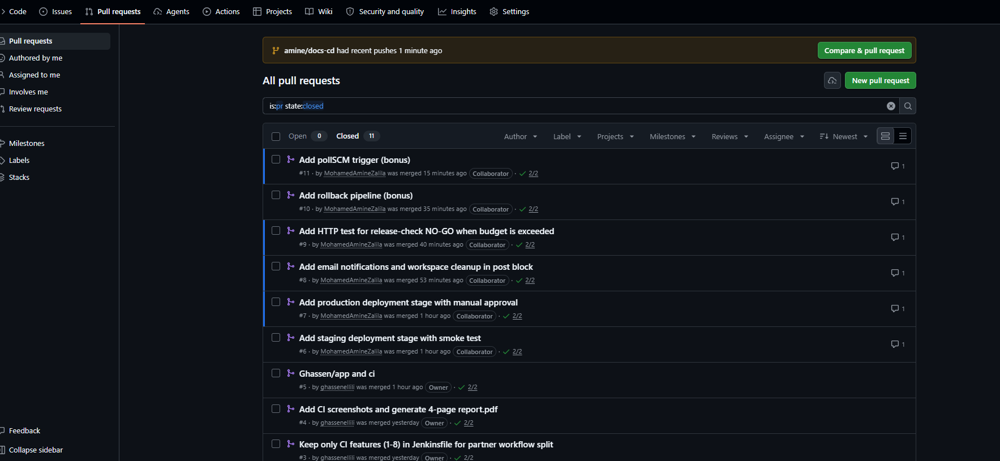
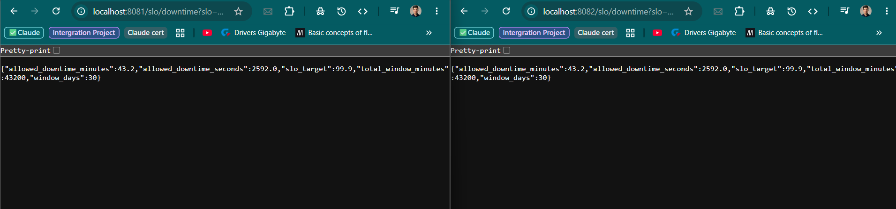
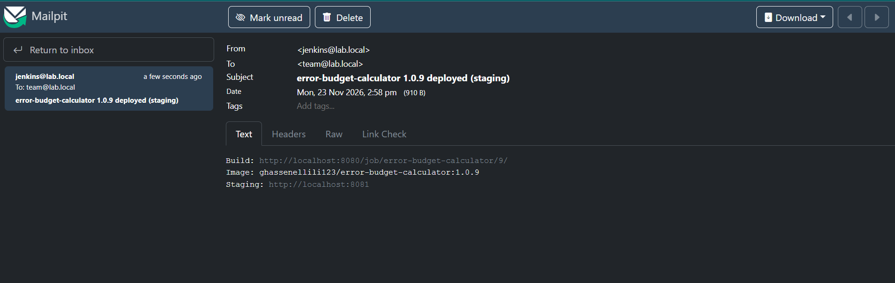
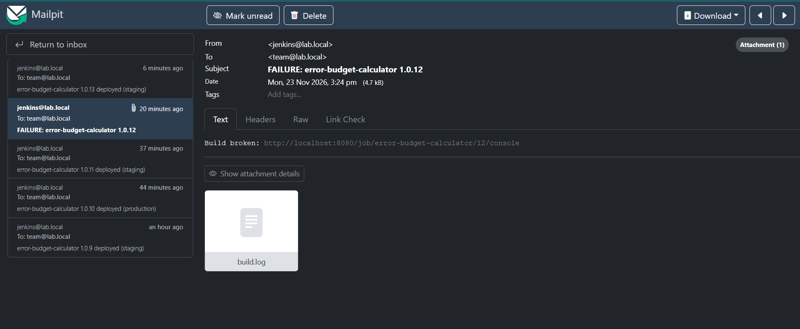
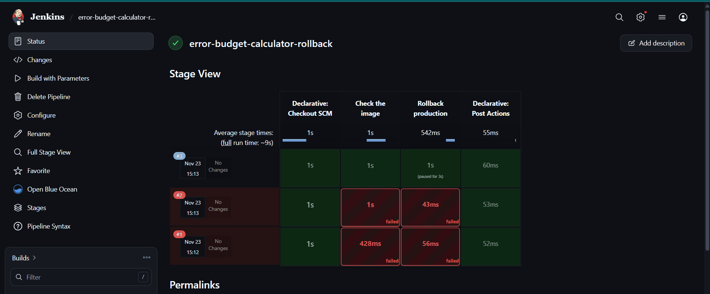
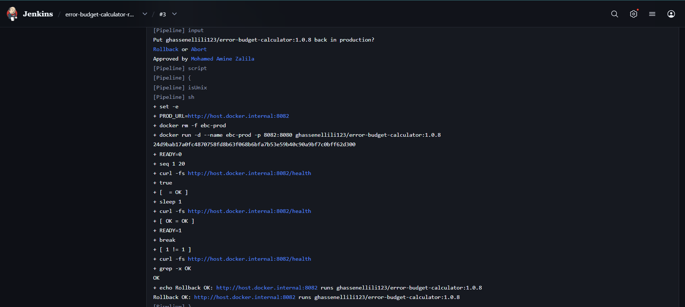

# Rapport de Projet Final — CI/CD with Jenkins & Docker
## Application : SRE Error Budget Calculator

- **Établissement** : Horizon School of Digital Technologies
- **Binôme** : **Ghassen Ellili** (CI — Features 1 à 8 & Bonus CI) & **Mohamed Amine Zalila** (CD — Features 9 à 12 & Bonus CD)
- **Dépôt GitHub** : `https://github.com/ghassenellili/Projet-CICD-JENKINS`
- **Dépôt Docker Hub** : `https://hub.docker.com/r/ghassenellili123/error-budget-calculator` (Collaborateurs : `ghassenellili123` & `aminezalila`)

---

## 1. Présentation de l'application, du scénario métier et du travail en binôme

L'application **SRE Error Budget Calculator** est un microservice web et API REST développé en **Python (Flask)**. Dans une organisation DevOps/SRE, la décision d'autoriser ou de bloquer une mise en production repose sur le **Budget d'Erreur (Error Budget)** défini par le *Service Level Objective (SLO)* (par exemple `99.9%` de disponibilité sur 30 jours, soit `43.2 minutes` d'indisponibilité tolérée ou `100` requêtes en échec sur `100 000`).

Notre application expose :
- `GET /health` : retourne `OK` (HTTP 200), utilisé par le `HEALTHCHECK` Docker et les smoke tests Jenkins.
- `GET /slo/downtime?slo=99.9&days=30` : calcule le temps d'indisponibilité maximal autorisé (`43.2 min` / `2592.0 s`).
- `POST /slo/budget` : calcule le nombre d'erreurs HTTP tolérées, le budget restant et le pourcentage consommé.
- `POST /slo/burn-rate` : calcule la vitesse de consommation du budget (*Burn Rate*) et détermine le niveau d'alerte (`NORMAL`, `WARNING`, `HIGH`, `CRITICAL`).
- `POST /slo/release-check` : agit comme une barrière de déploiement automatique (*Release Gate*) en retournant `GO`, `CAUTION` ou `NO-GO`.

### Répartition en binôme et workflow Git (Pull Requests)
Le développement a été réparti équitablement sur un dépôt public unique avec des branches nominatives (`ghassen/...` pour la logique applicative et la CI Features 1–8 ; `amine/...` pour la CD Features 9–12, les tests HTTP additionnels et le job de rollback), chaque évolution étant fusionnée sur `main` via une **Pull Request** relue et validée par le binôme :

---

## 2. Vue d'ensemble du Pipeline Jenkins (Features 1 à 12)

### Explication détaillée de chaque Stage (CI : Stages 1–6 / CD : Stages 7–8 & Post)

| Stage / Bloc | Responsable | Rôle technique | Pourquoi ce stage est indispensable |
| :--- | :--- | :--- | :--- |
| **1. Checkout SCM & Build** *(Features 1, 2, 5)* | Ghassen (CI) | Clone le dépôt Git, lit les paramètres (`DEPLOY_ENV`, `SLO_TARGET`), crée `.venv`, installe `requirements.txt` et prépare l'archive `build/dist/*.tar.gz`. | Garantit que toute la configuration vient de Git (*Pipeline from SCM*) et que l'application s'installe proprement avant les tests. |
| **2. Tests (Parallel : `Unit tests` & `HTTP tests`)** *(Features 3, 4)* | Ghassen (CI) & Amine | Exécute simultanément **7 tests unitaires** (`test_unit.py`) et **6 tests HTTP** (`test_http.py`) avec `pytest --junitxml=...`, puis publie les rapports via `junit`. | Le parallélisme réduit le temps de feedback. La publication JUnit passe le build en **jaune (`UNSTABLE`)** si un test échoue et bloque la suite. |
| **3. Package (Artifacts)** *(Feature 6)* | Ghassen (CI) | Archive le paquet `.tar.gz`, `version.txt` et les rapports XML JUnit avec `archiveArtifacts(..., fingerprint: true)`. | Assure la traçabilité complète par empreinte MD5 (*fingerprint*) entre un build Jenkins et ses fichiers produits. |
| **4. Docker image** *(Feature 7)* | Ghassen (CI) | Construit l'image `ghassenellili123/error-budget-calculator:1.0.${BUILD_NUMBER}` uniquement si `currentResult == 'SUCCESS'`. | Garantit qu'aucune image n'est construite si un test échoue (build jaune) et interdit le tag ambigu `latest`. |
| **5. Security scan (Trivy)** *(Bonus CI)* | Ghassen (CI) | Analyse l'image Docker locale avec **Aqua Trivy** (`--exit-code 1 --severity CRITICAL`) et le volume de cache `trivy-cache`. | Bloque immédiatement le pipeline avant le push sur Docker Hub si une vulnérabilité critique (CVE) est détectée. |
| **6. Push** *(Feature 8 + Bonus)* | Ghassen (CI) | Authentifie Jenkins sur Docker Hub via `withCredentials` (`dockerhub-token` Read & Write) et pousse l'image dans un bloc `retry(3)`. | Publie l'artefact immuable sur Docker Hub tout en tolérant les micro-coupures réseau grâce aux 3 tentatives automatiques. |
| **7. Deploy to staging** *(Feature 9)* | Amine (CD) | Remplace le conteneur `ebc-staging` sur le port `8081` avec l'image `${IMAGE_TAG}`, attend `/health` = `OK` (jusqu'à 20 s) et vérifie `/slo/downtime?slo=99.9&days=30` (`43.2`). | Prouve que l'image réellement publiée démarre et répond exactement comme attendu dans un conteneur avant toute mise en production. |
| **8. Deploy to production** *(Feature 10)* | Amine (CD) | Si `DEPLOY_ENV == 'production'` et build `SUCCESS` : pause avec approbation manuelle (`input`), puis déploie **la même image** dans `ebc-prod` sur le port `8082` et vérifie `/health`. | Maintient un contrôle humain avant la production et garantit que l'image en production est strictement identique à celle validée en staging. |
| **Post Actions (`emailext` & `cleanWs()`)** *(Features 11, 12)* | Amine (CD) | Envoie un e-mail via **Mailpit** (`team@lab.local`) avec la version `1.0.${BUILD_NUMBER}` dans l'objet (`success`, `unstable`, `failure` avec `build.log` joint), puis exécute `cleanWs()`. | Prévenir immédiatement l'équipe SRE de chaque résultat avec les journaux et liens utiles, et éviter la saturation du disque Jenkins. |

---

## 3. Fonctionnalités Bonus Implémentées (Section 5)

Notre binôme a implémenté **6 fonctionnalités bonus** complémentaires :

1. **Security scan avec Trivy (Bonus CI — Stage `Security scan (Trivy)`)** :
   - *Problème résolu* : Une image dont le code passe les tests unitaires peut contenir des failles critiques dans ses paquets système ou Python. `aquasec/trivy:latest image --exit-code 1 --severity CRITICAL` avec le volume `trivy-cache` bloque le pipeline avant le push sur Docker Hub en cas de CVE critique.
2. **Job de Rollback en Production (`Jenkinsfile.rollback` — Bonus CD)** :
   - *Problème résolu* : Si une version déployée en production présente une anomalie métier, il faut pouvoir revenir en quelques secondes à une version antérieure saine sans recompiler ni modifier Git. Le job `error-budget-calculator-rollback` prend le paramètre `ROLLBACK_TO` (ex. `1.0.8`), vérifie d'abord l'existence du tag sur Docker Hub via `docker pull` (stage `Check the image`), demande une approbation manuelle (`input`), puis redéploie `ebc-prod` sur le port `8082` et valide `/health`.
3. **Déclenchement automatique `pollSCM` (Bonus CD)** :
   - *Problème résolu* : Sans déclencheur automatique, un développeur peut oublier de lancer Jenkins après un merge. La directive `triggers { pollSCM('H/5 * * * *') }` interroge GitHub toutes les 5 minutes et lance le pipeline dès qu'un nouveau commit est détecté.
4. **Timeouts et Retries (`options { timeout(...) }` & `retry(3)` — Bonus CI)** :
   - *Problème résolu* : `timeout(time: 15, unit: 'MINUTES')` évite qu'un processus ou un `input` oublié ne bloque un exécuteur Jenkins indéfiniment, tandis que `retry(3)` sur `docker push` absorbe les erreurs réseau transitoires vers Docker Hub.
5. **Health Check Docker & Smoke Test complet (Bonus CI/CD)** :
   - *Problème résolu* : Un conteneur peut être `Up` alors que le serveur Flask interne ne répond plus. L'instruction `HEALTHCHECK` du `Dockerfile` vérifie `/health` toutes les 15 secondes (visible via le statut `(healthy)` dans `docker ps`), et le smoke test de staging valide `/health` et `/slo/downtime`.
6. **Workflow GitHub Actions (`.github/workflows/ci.yml` — Bonus CI)** :
   - *Comparaison avec Jenkins* : GitHub Actions (YAML, runners cloud éphémères `ubuntu-latest`) valide automatiquement chaque push et Pull Request sur GitHub, tandis que notre `Jenkinsfile` (DSL Groovy, serveur local) pilote directement le démon Docker local pour construire l'image, la scanner avec Trivy, gérer l'état jaune `UNSTABLE` via JUnit et déployer les conteneurs sur les ports `8081` et `8082`.

---

## 4. Principaux problèmes rencontrés et comment nous les avons résolus

1. **Le build passait au rouge (`FAILURE`) au lieu de jaune (`UNSTABLE`) lorsqu'un test échouait** :
   - *Cause* : Un code retour non nul de `pytest` arrêtait immédiatement l'étape `sh`/`bat` en `FAILURE` avant l'exécution du plugin `junit`.
   - *Solution* : Ajout de `|| true` (Linux) et `|| exit /b 0` (Windows) après `python -m pytest --junitxml=...` et publication via `junit 'build/test-results/*.xml'` dans `post { always }`. Le plugin JUnit marque ainsi le build en **jaune (`UNSTABLE`)**, et `when { expression { currentBuild.currentResult == 'SUCCESS' } }` ignore automatiquement les stages Docker, Trivy, Push et Déploiement.
2. **Authentification et permissions Docker Hub (`credsStore: desktop` & `insufficient scopes`)** :
   - *Cause* : Sur Windows, `"credsStore": "desktop"` empêchait le service Jenkins d'enregistrer le login Docker en arrière-plan ; de plus, le second membre du binôme (`aminezalila`) et un token *Read-only* recevaient `access token has insufficient scopes` lors du push.
   - *Solution* : Isolation de la configuration Docker par build (`$WORKSPACE/.docker-cfg/config.json`), ajout de `aminezalila` comme **collaborateur** sur le dépôt Docker Hub `ghassenellili123/error-budget-calculator`, et création de tokens **Read & Write** stockés dans Jenkins Credentials (`dockerhub-token`).
3. **Conflits de ports (`8080 / 8081 / 8082`) et communication conteneur-hôte / Git Bash (`MSYS_NO_PATHCONV`)** :
   - *Cause* : D'anciens conteneurs occupaient déjà les ports `8081`/`8082`, Git Bash sous Windows réécrivait les chemins de volumes Linux (`/var/run/docker.sock`), et l'image Jenkins standard ne contenait pas `python3`.
   - *Solution* : Construction d'une image `jenkins-python`, utilisation de `MSYS_NO_PATHCONV=1` sous Git Bash, nettoyage systématique des conteneurs (`docker rm -f ebc-staging` / `ebc-prod`) avant déploiement, et prise en charge hybride Linux (`host.docker.internal`) / Windows (`localhost`) via `if (isUnix())` dans tous les stages du `Jenkinsfile`.

---

## 5. Preuves d'exécution complètes (CI & CD)

### A. Build Jaune (`UNSTABLE`) lorsqu'un test échoue : les stages Docker, Trivy et Push sont ignorés (*skipped*)

### B. Dépôt Docker Hub `ghassenellili123/error-budget-calculator` mis à jour

### C. Conteneurs Staging (`8081`) et Production (`8082`) actifs avec statut `(healthy)` (`docker ps`)

### D. Application répondant en Staging (`:8081`) et en Production (`:8082`) dans le navigateur

### E. Notifications E-mail dans Mailpit (Succès et Échec avec `build.log` joint)

### F. Job Bonus de Rollback (`error-budget-calculator-rollback`)

