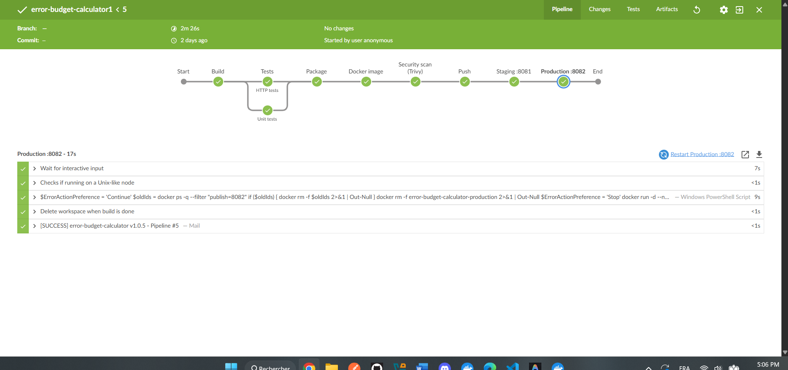
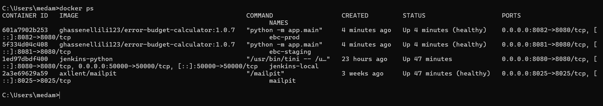

# Rapport de Projet Final — CI/CD with Jenkins & Docker
## Application : SRE Error Budget Calculator

- **Établissement** : Horizon School of Digital Technologies
- **Binôme** : Ghassen Ellili (CI — Features 1 à 8) & Mohamed Amine Zalila (CD — Features 9 à 12)
- **Dépôt GitHub** : `https://github.com/ghassenellili/Projet-CICD-JENKINS`
- **Dépôt Docker Hub** : `https://hub.docker.com/r/ghassenellili123/error-budget-calculator` (Collaborateurs : `ghassenellili123` & `aminezalila`)

---

## 1. Présentation de l'application et du scénario métier

L'application **SRE Error Budget Calculator** est un microservice web et API REST développé en **Python (Flask)**. Dans une organisation DevOps/SRE, la décision d'autoriser ou de bloquer une mise en production repose sur le **Budget d'Erreur (Error Budget)** défini par le *Service Level Objective (SLO)* (par exemple `99.9%` de disponibilité sur 30 jours, soit `43.2 minutes` d'indisponibilité tolérée).

Notre application expose :
- `GET /health` : retourne `OK` (HTTP 200), utilisé par le `HEALTHCHECK` Docker et le smoke test Jenkins.
- `GET /slo/downtime?slo=99.9&days=30` : calcule le temps d'indisponibilité maximal autorisé en minutes et secondes (`43.2 min` / `2592.0 s`).
- `POST /slo/budget` : calcule le nombre d'erreurs HTTP tolérées, le budget restant et le pourcentage consommé.
- `POST /slo/burn-rate` : calcule la vitesse de consommation du budget (*Burn Rate*) et détermine le niveau d'alerte (`NORMAL`, `WARNING`, `HIGH`, `CRITICAL`).
- `POST /slo/release-check` : agit comme une barrière de déploiement automatique (*Release Gate*) en retournant `GO`, `CAUTION` ou `NO-GO`.

---

## 2. Vue d'ensemble du Pipeline Jenkins (Blue Ocean)

### Explication détaillée de chaque Stage (et pourquoi il est nécessaire)

| Stage | Rôle technique | Pourquoi ce stage est indispensable |
| :--- | :--- | :--- |
| **1. Build** | Crée un environnement virtuel isolé (`.venv`), installe les dépendances depuis `requirements.txt` et prépare l'archive de distribution `build/dist/*.tar.gz`. | Garantit que l'application et ses dépendances s'installent proprement avant de lancer les tests. |
| **2. Tests (Parallel : `Unit tests` & `HTTP tests`)** | Exécute simultanément **7 tests unitaires** (`tests/test_unit.py`) et **5 tests HTTP** (`tests/test_http.py`) avec `python -m pytest --junitxml=...`, puis publie les rapports via `junit`. | Le parallélisme réduit le temps de feedback CI. La publication JUnit passe le build en **jaune (`UNSTABLE`)** si un test échoue, empêchant la création d'une image défectueuse. |
| **3. Package (Artifacts)** | Archive le paquet de build et les rapports XML JUnit avec `archiveArtifacts(..., fingerprint: true)`. | Assure la traçabilité complète (empreinte MD5/fingerprint) entre un numéro de build Jenkins et les fichiers produits. |
| **4. Docker image** | Construit l'image Docker taguée `ghassenellili123/error-budget-calculator:1.0.${BUILD_NUMBER}` uniquement si `currentBuild.currentResult == 'SUCCESS'`. | Garantit qu'aucune image n'est construite si un test est en échec (build jaune) et interdit l'usage du tag ambigu `latest`. |
| **5. Security scan (Trivy)** *(Bonus)* | Analyse l'image Docker locale avec **Aqua Trivy** (`--exit-code 1 --severity CRITICAL`) en utilisant le volume de cache `trivy-cache`. | Bloque immédiatement le pipeline avant le push sur Docker Hub si une vulnérabilité critique (CVE) est présente dans l'image. |
| **6. Push** | Authentifie Jenkins auprès de Docker Hub via `withCredentials` (`dockerhub-token` Read & Write) et pousse l'image dans un bloc `retry(3)`. | Publie l'artefact immuable dans un registre distant tout en tolérant les micro-coupures réseau grâce aux 3 tentatives automatiques. |
| **7. Staging :8081** | Déploie le conteneur sur le port `8081`, vérifie que `GET /health` répond `OK`, puis exécute un smoke test sur `/slo/downtime?slo=99.9&days=30` en vérifiant la réponse exacte (`43.2`). | Valide que le conteneur réel démarre et répond correctement aux requêtes HTTP avant de solliciter une validation humaine. |
| **8. Production :8082** | Si `DEPLOY_ENV == 'production'`, met le pipeline en pause avec une étape `input` d'approbation manuelle, puis déploie **exactement la même image** sur le port `8082`. | Implémente le contrôle humain final (*Continuous Delivery*) et garantit que l'image testée en staging est identique à celle mise en production. |
| **Post Actions (`mail` & `cleanWs()`)** | Envoie un e-mail via **Mailpit** contenant la version `v1.0.${BUILD_NUMBER}` dans l'objet (succès, instable ou échec), puis nettoie l'espace de travail avec `cleanWs()`. | Informe immédiatement l'équipe SRE de l'état de la livraison et évite la saturation du disque du serveur Jenkins. |

---

## 3. Fonctionnalités Bonus Implémentées

Nous avons implémenté **4 fonctionnalités bonus** de la Section 5 :

1. **Security scan avec Trivy (Bonus 1)** :
   - *Problème résolu* : Une image Docker dont le code applicatif passe les tests unitaires peut tout de même contenir des librairies système ou Python présentant des failles de sécurité critiques. En exécutant `aquasec/trivy:latest image --exit-code 1 --severity CRITICAL` avec un volume de cache `trivy-cache` juste avant le stage `Push`, toute faille critique casse le build en rouge et empêche la publication sur Docker Hub.
2. **Timeouts et Retries (Bonus 2)** :
   - *Problème résolu* : Un processus bloqué ou une étape `input` oubliée peut monopoliser un exécuteur Jenkins indéfiniment ; à l'inverse, un timeout réseau passager vers Docker Hub peut faire échouer tout un build valide. L'option globale `options { timeout(time: 15, unit: 'MINUTES') }` protège les ressources Jenkins, et `retry(3)` autour de `docker push` fiabilise la publication réseau.
3. **Health Check complet (Bonus 3)** :
   - *Problème résolu* : Un conteneur Docker peut être à l'état `Up` (`running`) alors que le serveur web interne est planté ou bloqué. L'instruction `HEALTHCHECK` dans le `Dockerfile` interroge périodiquement `http://localhost:8080/health`, et le smoke test de staging vérifie à la fois `/health` (`OK`) et un calcul métier réel sur `/slo/downtime`.
4. **GitHub Actions CI Workflow (Bonus 4 — `.github/workflows/ci.yml`)** :
   - *Comparaison Jenkinsfile vs GitHub Actions* :
     - **Hébergement & Exécution** : GitHub Actions est *SaaS / cloud-managed* (`runs-on: ubuntu-latest`) et se déclenche nativement sur chaque `push` et `pull_request` sans serveur à maintenir, tandis que **Jenkins** est *self-hosted* (ayant accès au démon Docker local pour construire, scanner et déployer les conteneurs sur les ports `8081` et `8082`).
     - **Syntaxe & Écosystème** : GitHub Actions utilise du **YAML** déclaratif avec des actions réutilisables (`actions/checkout@v4`, `actions/setup-python@v5`), alors que le `Jenkinsfile` utilise un DSL **Groovy** déclaratif permettant une orchestration fine des étapes `parallel`, `when`, `input` (approbation humaine) et `junit` (état jaune `UNSTABLE`).

---

## 4. Trois problèmes rencontrés et comment nous les avons résolus

### Problème 1 : Le build passait au rouge (`FAILURE`) au lieu de jaune (`UNSTABLE`) lorsqu'un test échouait
- **Cause** : Par défaut dans Jenkins, lorsque `pytest` retourne un code de sortie différent de `0` (test en échec), l'étape `sh` / `bat` échoue immédiatement et marque le stage en `FAILURE` (rouge) avant même que le plugin `junit` ne puisse analyser le rapport XML.
- **Solution** : Nous avons ajouté `|| exit /b 0` (sous Windows) et `|| true` (sous Linux) à la commande `python -m pytest ... --junitxml=...`, et placé `junit 'build/test-results/*.xml'` dans le bloc `post { always { ... } }` du stage `Tests`. Ainsi, c'est le plugin `junit` qui évalue les fichiers XML et passe proprement le build à l'état **jaune (`UNSTABLE`)** en cas de test cassé, tandis que la condition `when { expression { currentBuild.currentResult == 'SUCCESS' } }` bloque la construction de l'image Docker, le scan Trivy et le Push.

### Problème 2 : Échec de `docker push` sur Windows à cause de `credsStore: desktop` et des permissions du token Docker Hub
- **Cause** : Sur Windows, le fichier global `.docker/config.json` utilise `"credsStore": "desktop"`. Or, le service Jenkins s'exécute sous un compte système sans accès au trousseau graphique de la session utilisateur, ce qui empêchait `docker login` d'enregistrer le token. De plus, un token Docker Hub créé par défaut en *Read-only* refusait le push avec l'erreur `access token has insufficient scopes`.
- **Solution** : Nous avons isolé la configuration Docker du build dans un répertoire temporaire propre au workspace (`$WORKSPACE/.docker-cfg/config.json`) et généré un Personal Access Token Docker Hub avec les droits **`Read & Write`** stocké dans Jenkins Credentials (`dockerhub-token`).

### Problème 3 : Conflit de port (`port is already allocated`) et erreur `ModuleNotFoundError: No module named 'app'`
- **Cause** : Lors de l'exécution de `pytest` en CI, le dossier racine n'était pas dans le `PYTHONPATH`, provoquant `ModuleNotFoundError: No module named 'app'`. Par ailleurs, d'anciens conteneurs occupaient déjà le port `8081` lors du déploiement.
- **Solution** : Nous avons ajouté un fichier `pytest.ini` avec `pythonpath = .` (et utilisé `python -m pytest`), et ajouté un nettoyage automatique des conteneurs occupant le port cible (`docker ps -q --filter "publish=8081"`) avant chaque déploiement.

---

## 5. Preuves d'exécution (Captures d'écran)

### A. Build Jaune (`UNSTABLE`) lorsqu'un test échoue : les stages Docker, Trivy et Push sont ignorés (*skipped*)

### B. Dépôt Docker Hub `ghassenellili123/error-budget-calculator` mis à jour après le stage `Push`

---

## 6. Partie Continuous Delivery (Mohamed Amine Zalila)

Cette partie prolonge le pipeline CI de Ghassen. Elle a été développée sur des branches `amine/...` (`amine/cd-staging`, `amine/cd-production`, `amine/cd-notify-cleanup`, `amine/http-test-release-check`, `amine/bonus-rollback`, `amine/bonus-poll-trigger`, `amine/docs-cd`), chacune fusionnée sur `main` par une Pull Request relue par Ghassen. Principe commun : l'image construite et poussée par la CI est **réutilisée telle quelle** (jamais reconstruite) pour être déployée.

### 6.1 Les stages de livraison (features 9 à 12) et pourquoi ils existent

| Stage | Ce qu'il fait | Pourquoi |
| :--- | :--- | :--- |
| **9. `Deploy to staging`** | Supprime l'ancien conteneur `ebc-staging`, lance l'image `${IMAGE_TAG}` sur le port `8081`, attend jusqu'à 20 s que `/health` réponde exactement `OK`, puis exécute un smoke test (`/health` = `OK` et `/slo/downtime?slo=99.9&days=30` contient `"allowed_downtime_minutes":43.2`). Une réponse incorrecte fait échouer le stage. | Prouver que l'image réellement publiée démarre et répond correctement dans un conteneur, avant toute mise en production. |
| **10. `Deploy to production`** | Seulement si `DEPLOY_ENV == 'production'` et build `SUCCESS` : approbation manuelle (`input`, bouton **Deploy**), puis **la même image** dans `ebc-prod` sur le port `8082`, avec vérification de `/health`. | Garder un contrôle humain avant la production, et garantir que ce qui tourne en production est exactement ce qui a été validé en staging. |
| **11. Notifications e-mail** | Bloc `post` : `emailext` vers `team@lab.local` (Mailpit) en cas de succès (version, URL du build, URLs déployées), d'instabilité (lien vers le rapport de tests, log joint) ou d'échec (lien vers la console, log joint). | L'équipe est prévenue de chaque résultat avec les bons liens, sans surveiller Jenkins. |
| **12. Nettoyage** | `cleanWs()` dans `post { always { ... } }`. | Éviter que les espaces de travail (`.venv`, `build/`) saturent le disque de Jenkins. |

Chaque stage contient une branche Linux (`sh`) et une branche Windows (`bat` / `powershell`). Mon Jenkins est un conteneur Linux, qui joint l'hôte via `http://host.docker.internal` ; la branche Windows (`http://localhost`) n'a pas été testée sur Jenkins. Nous avons aussi ajouté un test HTTP supplémentaire (`POST /slo/release-check` avec 150 requêtes en échec sur 100 000 pour un SLO de 99,9 % doit retourner `NO-GO`).

### 6.2 Mes deux fonctionnalités bonus

1. **Job de rollback (`Jenkinsfile.rollback`)**
   - *Problème résolu* : si une version déployée est mauvaise, il faut revenir rapidement à une version connue comme saine, sans rebuild ni modification du code. Le job prend en paramètre `ROLLBACK_TO` (numéro de version uniquement, par exemple `1.0.8`). Le stage `Check the image` fait un `docker pull` : si le tag n'existe pas, le job échoue **avant** de toucher à la production. Le stage `Rollback production` demande une confirmation (`input`, bouton **Rollback**), remplace `ebc-prod` par cette image sur le port `8082` et vérifie `/health`.
   - *Pourquoi un fichier séparé* : c'est un job à la demande, avec son propre paramètre, qui ne construit rien. Le laisser hors du `Jenkinsfile` principal évite d'ajouter de la logique de production à chaque build normal.
2. **Déclenchement automatique (`pollSCM`)**
   - *Problème résolu* : sans déclencheur, un build n'a lieu que si quelqu'un clique sur *Build*. `triggers { pollSCM('H/5 * * * *') }` fait interroger GitHub par Jenkins environ toutes les 5 minutes et lance un build dès qu'un nouveau commit est détecté.

### 6.3 Quatre problèmes rencontrés et leur solution

**Problème 1 : Git Bash modifiait les chemins Linux dans les commandes `docker`**
- **Cause** : Git Bash (MSYS) convertit automatiquement les arguments qui ressemblent à des chemins Unix en chemins Windows. Un chemin Linux destiné au conteneur (par exemple un volume `-v /var/run/docker.sock:/var/run/docker.sock`) était donc réécrit avant d'arriver à Docker.
- **Solution** : préfixer la commande par `MSYS_NO_PATHCONV=1` (par exemple `MSYS_NO_PATHCONV=1 docker run ...`) pour désactiver cette conversion.

**Problème 2 : Conflits de ports 8080 / 8081 / 8082**
- **Cause** : d'anciens conteneurs occupaient déjà les ports, et le conteneur Jenkins lui-même entrait en conflit avec les ports de l'application (staging `8081`, production `8082`). De plus, Jenkins gardait en mémoire l'ancienne adresse, si bien que le lien du build dans l'e-mail pointait vers `localhost:8081` (le staging) au lieu de Jenkins.
- **Solution** : nous avons libéré les ports (suppression des anciens conteneurs) et remappé Jenkins sur le port `8080`. L'adresse Jenkins a été corrigée dans *Manage Jenkins > System > Jenkins URL* (`http://localhost:8080/`). Les stages de déploiement exécutent aussi `docker rm -f` sur leur conteneur avant de le recréer.

**Problème 3 : `docker push` refusé avec `insufficient scopes`**
- **Cause** : mon compte Docker Hub n'avait pas les droits d'écriture sur le dépôt `ghassenellili123/error-budget-calculator`, et un token en lecture seule ne permet pas de pousser.
- **Solution** : Ghassen m'a ajouté comme **collaborateur** du dépôt Docker Hub, et j'ai créé mon propre token **Read & Write**, enregistré dans les Jenkins Credentials sous l'identifiant `dockerhub-token`. Le `Jenkinsfile` ne contient que cet identifiant, jamais le secret.

**Problème 4 : l'image Jenkins officielle ne contenait pas Python**
- **Cause** : les stages `Build` et `Tests` appellent `python3` et `pip`, absents de l'image Jenkins standard : le build échouait dès le premier stage.
- **Solution** : construire une image Jenkins personnalisée (`jenkins-python`) qui ajoute Python, et lancer notre conteneur Jenkins avec cette image.

### 6.4 Preuves d'exécution

#### A. Staging et production actifs (`docker ps`)

#### B. Application répondant sur staging (8081) et production (8082)

#### C. E-mail de succès reçu dans Mailpit

#### D. Job de rollback

### 6.5 Ce qui a été vérifié et ce qui ne l'a pas été

- **Vérifié sur Jenkins** : le déploiement staging et production (avec approbation), l'e-mail de succès (staging et production), le message de nettoyage `cleanWs()` dans la console, le test HTTP supplémentaire et le job de rollback.
- **Configuré mais non testé en conditions réelles** : les e-mails d'**échec** et d'**instabilité** (log joint) et les branches **Windows** (`bat` / `powershell`) de nos stages.
